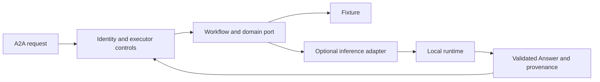

# Local model adapter boundary

Status: Design guidance. No model or inference adapter is installed by this lab.
The [runtime/setup guide](local-model-integration.md) supplies M5 selection and
setup guidance. Actual model integration remains an explicit optional extension.
The required path remains deterministic, without model credentials.

## Integration point

Keep A2A serving and inference separate. Implement the existing `KnowledgeLookup`
port with `async answer(question: str) -> Answer`, and inject it in `bootstrap.py`
through an explicit validated setting. Retain fixtures, and fail clearly when an
opted-in provider is unavailable; do not label a fixture fallback as inference.
No SDK wire type crosses this port.

Models do not create credentials, choose peers/tools, grant approval, or control
execution destinations. Application code retains those decisions.

## Controls an adapter must preserve

| Boundary | Required adapter behavior |
| --- | --- |
| Context | Bound inputs; pass authorized data only. Keep identity/tokens outside prompts, and retrieved/peer/tool text separate from trusted instructions. |
| Output | Validate bounded `Answer` and reject extra fields. Attach references from known retrieval data; invented citations are not verified provenance. Never execute generated code, links, or approval flags. |
| Network | Define a separate approved inference endpoint; A2A peer policy does not authorize model URLs. Disable implicit proxies/redirects and bound bodies. |
| Budgets | Bound calls, concurrency, time, tokens/context, and resources. Measure representative workloads before changing the current workflow deadline. |
| Cancellation | Own inference work and prevent late artifacts. Blocking/GPU work may need worker-process controls; cancelling an HTTP wait may leave server-side inference running. |
| Errors and audit | Preserve failed versus unknown outcomes, avoid blind retries, and keep prompts/private data/credentials/raw provider responses out of routine logs. |
| Authority | Preserve user/service/human separation, resource ownership, and exact approvals even when generated text recommends bypassing them. |
| Evaluation | Keep deterministic policy tests and add opt-in model evaluations for injection, disclosure, invalid output, and workload limits. Record runtime/model versions and observed limits. |

Use the [constitution](../constitution.md) and
[OWASP agent security](https://cheatsheetseries.owasp.org/cheatsheets/AI_Agent_Security_Cheat_Sheet.html)
to review the untrusted-content and execution boundaries.

## Before acquiring a model

Record OS/architecture, RAM/GPU/VRAM, concurrent users, latency/context targets,
and disk budget. Review model license, source/provenance, and any downloaded-code
requirement. Choose a compatible runtime and model/quantization from current
official documentation, then benchmark representative inputs and memory pressure.

In Docker, add inference as an opt-in service with separate resources/storage
and explicit connectivity. The current private namespace has no approved model
endpoint. Host versus container serving, GPU support, and stop/cancel semantics
depend on the chosen hardware/runtime. M4 supplies no runtime-specific installation
commands or performance promise; model acquisition/connectivity is optional work.
